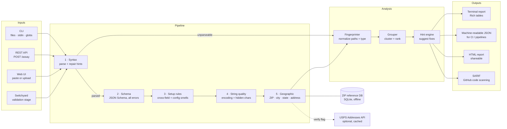
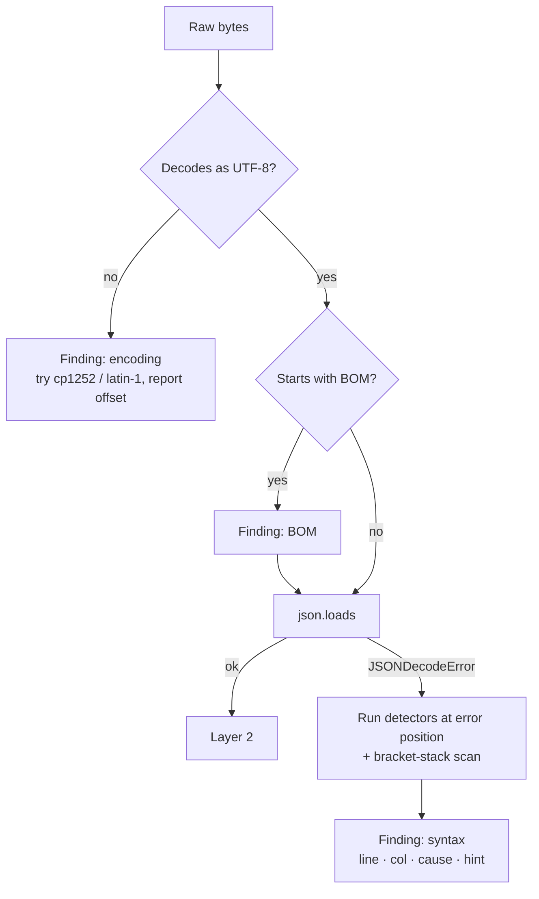
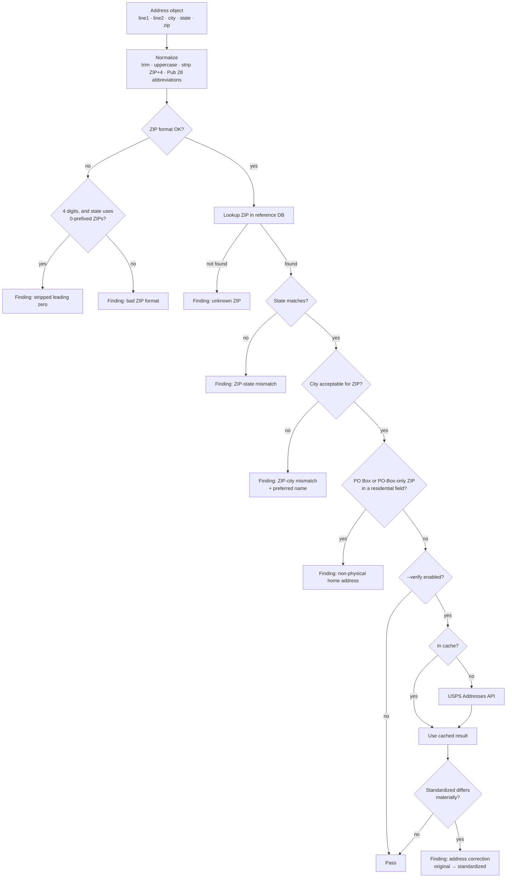
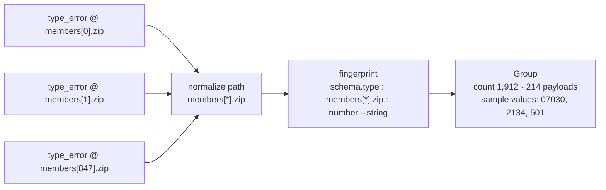
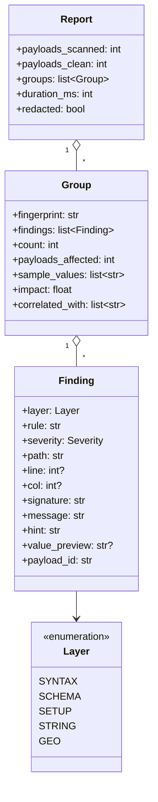
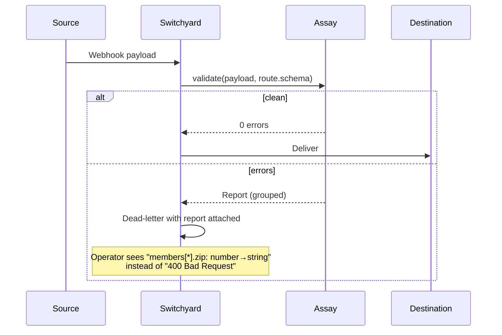

# Assay — Architecture

> A JSON payload error identifier. Assay takes one payload or ten thousand, runs them through layered checks (syntax, schema, setup rules, string quality, and geographic validation), then **groups every error by root cause** so you fix one mapping instead of reading 4,000 identical failures.

> **Implementation status (v1.0).** This document is the target design. **Milestones
> M1–M7 are built, tested and shipped:** syntax, schema, setup rules, string quality,
> offline geography, opt-in USPS verification, grouping, redaction, HTML/SARIF, the HTTP
> API with a paste-in page, and Docker. **M8 is built in the separate Switchyard
> project** (v0.1.0): signed ingest, routing, retries and a DLQ that stores the grouped
> report. The README describes what runs in this repository.

**Stack today:** Python 3.11+ · jsonschema (Draft 2020-12) · ftfy · PyYAML · Pydantic ·
usaddress · SQLite (bundled ZIP reference and USPS cache) · USPS Addresses API v3 (opt-in) ·
Typer (CLI) · Rich (terminal reports) · FastAPI + uvicorn (optional API and web page) ·
pytest + Hypothesis · Docker · GitHub Actions (ruff → mypy --strict → pytest → docker)

**Stack planned:** Switchyard integration (M8)

---

## 1. Why this exists

Integration support work runs on the same loop: a payload fails, the error message is vague (`400 Bad Request`), and someone has to read raw JSON to find out *why*. The same root cause, such as a date format, an unmapped field or a copy-pasted smart quote, usually breaks hundreds of records at once, but tools report errors one at a time.

Assay answers three questions in seconds:

1. **Is it even valid JSON?** If not, exactly where and why.
2. **What's wrong with it?** Every error at once, each pinned to a JSON path.
3. **What's the actual root cause?** Errors clustered and ranked, with a fix hint.

Design goals:

- **Report everything, not just the first error.** Fail-fast is for runtimes; diagnosis needs the full picture.
- **Every finding has a location.** A JSON path (`members[3].dob`) and, for syntax errors, a line and column.
- **Every finding has a fix hint.** "Expected `YYYY-MM-DD`, got `03/14/1990`" beats "invalid format."
- **Rules are data.** Schemas and setup rules live in versioned files, not code.
- **Safe with sensitive data.** Reports can redact values and show only shapes and paths.

---

## 2. System overview



Each layer emits `Finding` objects into one stream. A syntax failure stops later layers for *that payload* only; the batch keeps going.

---

## 3. The five layers

### Layer 1: Syntax — **built**

Python's `json` module reports position (`JSONDecodeError.lineno`, `.colno`, `.pos`). Assay adds detectors that explain the **common human causes** behind a raw parse failure:

| Detector | Example | Hint |
|---|---|---|
| Trailing comma | `{"a": 1,}` | Remove comma at line 1, col 9 |
| Single quotes | `{'a': 1}` | JSON requires double quotes |
| Smart quotes | `{“a”: 1}` | Curly quotes from Word/Slack; replace with `"` |
| BOM | `{...}` | Byte-order mark at start of file; strip it |
| Unescaped newline in string | `"line one⏎line two"` | Use `\n` |
| Truncation | `{"a": [1, 2` | Unclosed `[` opened at line 1, col 7; payload likely cut off |
| Comments | `// note` | JSON has no comments; is this JSON5/JSONC? |
| NaN / Infinity | `{"x": NaN}` | Not valid JSON; use `null` or a string |

Truncation detection uses a bracket stack: it walks the text, tracks open `{` `[` `"` with their positions, and reports what's still open at EOF.



### Layer 2: Schema — **built**

`Draft202012Validator(schema).iter_errors(doc)` yields **every** violation with its path, instead of raising on the first. Assay maps each to a `Finding`:

- `required` → "Missing field `members[2].last_name`"
- `type` → "Expected string, got number at `group.id` (value: `40213`)", a classic unquoted-ID mistake
- `enum` → "`coverage_tier` = `employee_only`; allowed: `EMPLOYEE`, `EMPLOYEE_SPOUSE`, …", plus a closest-match suggestion
- `format` / `pattern` → date, email, and phone checks with the expected pattern shown
- `additionalProperties` → "Unknown field `frist_name`. Did you mean `first_name`?"

Format checkers are enabled explicitly (`FormatChecker()`); by default jsonschema treats `format` as annotation only, which is a common silent gap.

### Layer 3: Setup rules — **built (M4)**

Valid JSON that matches the schema can still be **wrong**. These rules catch configuration and mapping mistakes:

| Rule | What it catches |
|---|---|
| Cross-field ordering | `end_date` earlier than `start_date` |
| Conditional requirement | `type = "dependent"` but no `relationship` |
| Constant-value smell | A field holds the same value on 100% of records, e.g. every hire date is `1900-01-01`. Usually an unmapped field falling back to a default |
| Placeholder smell | Values like `TEST`, `N/A`, `string`, `xxx`, `0000000000` |
| Case drift | Same enum written three ways across a batch: `Active`, `ACTIVE`, `active` |
| Duplicate keys | `{"id": 1, "id": 2}` is legal to parse, but the first value is silently lost (detected with `object_pairs_hook`) |
| Duplicate records | Same natural key (e.g. `external_id`) appears twice in one batch |
| Type inconsistency | `zip` is a string in some records and a number in others; leading zeros are being stripped upstream |

Rules are declared in YAML:

```yaml
rules:
  - id: dates-ordered
    kind: compare
    left: "$.members[*].start_date"
    op: "<="
    right: "$.members[*].end_date"
    severity: error
    hint: "End date precedes start date. Check timezone or field mapping."

  - id: hire-date-default
    kind: constant_smell
    path: "$.members[*].hire_date"
    threshold: 0.95        # flag if ≥95% of records share one value
    severity: warning
    hint: "Nearly all records share one hire date. The field may be unmapped."
```

### Layer 4: String quality — **built (M4)**

Assay walks every string value and checks it for corruption that passes every schema:

| Check | Example | How |
|---|---|---|
| Mojibake | `José` → `José` | `ftfy.fix_text`; flag if the output differs, report the fix |
| Zero-width characters | `Smith​` | Scan for `U+200B–U+200D`, `U+FEFF`, `U+2060` |
| Non-breaking spaces | `New York` | Looks identical, fails string equality |
| Control characters | `\u0007` | Category `Cc` outside `\t\n\r` |
| Leading/trailing whitespace | `" Smith "` | Breaks matching and dedupe |
| Double-encoded JSON | `"{\"id\": 1}"` | String that itself parses as an object or array |
| Replacement character | `Mu�oz` | `U+FFFD` means data was already lost upstream |
| Length limits | 300-char `first_name` | `maxLength` from schema, or rule config |
| Homoglyphs | Cyrillic `а` in a Latin name | Mixed-script detection per token |

Findings show the invisible: `"Smith⟨U+200B⟩"` with the codepoint spelled out, because a report that says "bad character" next to text that looks fine is useless.

### Layer 5: Geographic — **offline built (M5); USPS verification built, opt-in (M6)**

Downstream systems (insurers, payroll, tax, shipping) routinely reject records whose ZIP, city and state don't agree, or whose "home address" isn't a physical residence. These pass every schema check, because `"75071"`, `"Dallas"` and `"OK"` are each perfectly valid strings. Layer 5 checks that they agree with each other and with reality.

**Two tiers:**

| Tier | Source | Cost | Catches |
|---|---|---|---|
| **Offline (default)** | Bundled SQLite ZIP reference: ZIP → state, county (with ratios), USPS preferred + acceptable city names, ZIP type (standard / PO Box only / unique / military) | Free, instant, no network, no PII leaves the machine | Invalid ZIPs, ZIP↔state, ZIP↔city, ZIP↔county mismatches, PO Box ZIPs used as home addresses |
| **Online (`--verify`)** | USPS Addresses API (OAuth 2.0, `apis.usps.com`) | Rate-limited; results cached by normalized address hash | Street-level validity, standardized form, ZIP+4, deliverability |

Offline is the default because it covers most real rejections with zero setup and zero data exposure. Online verification is opt-in, cached, and throttled.

**Checks:**

| Check | Example | Finding |
|---|---|---|
| ZIP format | `7507`, `750711`, `75071-12` | Must be `#####` or `#####-####` |
| Stripped leading zero | `7030` with state `NJ` | Likely `07030`; ZIP stored as a number upstream (pairs with the Layer 2 type finding) |
| ZIP exists | `00000`, `99999` | ZIP not in reference data |
| ZIP ↔ state | `75071` with state `OK` | 75071 is in TX (McKinney). Check state mapping or a swapped field |
| ZIP ↔ city | `75071` with city `Dallas` | Not an acceptable city name for 75071; USPS preferred is `MCKINNEY` |
| City alias | `75071` with city `Mc Kinney` | Acceptable variant; suggest the preferred form (info, not error) |
| ZIP ↔ county | `75071` with county `Dallas` | 75071 maps to Collin County. Only flagged when the county isn't among the ZIP's candidate counties, since ZIPs can span counties |
| State code validity | `TE`, `Tex.`, `Texas` | Expect a USPS two-letter code; suggest `TX` |
| Military addresses | `APO` with state `TX` | APO/FPO/DPO must use `AA`, `AE` or `AP` |
| PO Box as home address | `PO Box 123`, `P.O. Box`, `Post Office Box`, `PMB 44` | Residential address required; parsed with `usaddress`, plus ZIP type = PO Box only |
| Missing street number | `Main St` | Address line 1 has no primary number |
| Unit in wrong field | `123 Main St Apt 4` in line 1, line 2 empty | Suggest moving the unit to line 2 (configurable per destination) |
| Length limits | Line 1 at 52 chars | Over destination limit (configurable, e.g. 35 or 40) |

**Validation flow:**



**Batch-level geographic smells** (these feed straight into grouping):

| Smell | Likely cause |
|---|---|
| Many employee home addresses equal the employer's office address | Work address mapped into the home address field |
| Dependents in one household with different addresses | Address only copied for the primary member |
| All ZIP-state mismatches share one state value | State hard-coded or defaulted in a mapping |
| City and state values swapped on a subset of records | Column order changed in an upstream file or form |

**Which fields count as addresses** is declared, not guessed:

```yaml
geo:
  addresses:
    - path: "$.members[*].home_address"
      residential: true          # PO Boxes are errors here
      line1_max: 40
    - path: "$.employer.mailing_address"
      residential: false         # PO Boxes allowed
  verify:
    enabled: false               # opt-in; needs USPS_CLIENT_ID / USPS_CLIENT_SECRET
    cache_ttl_days: 30
    max_requests_per_minute: 30
```

**Reference data:** built at release time from GeoNames postal codes (CC BY 4.0, attributed in the README) and Census ZIP-to-county relationship files, packed into a ~5 MB SQLite file that ships with Assay. A `assay geo update` command rebuilds it. A licensed commercial ZIP database can be dropped in for USPS-grade city alias data.

**Privacy and terms:** offline checks never send data anywhere. `--verify` sends only address fields, never names or IDs, and is used solely to validate addresses that were already captured, which is how USPS permits its address API to be used.

---

## 4. Grouping: the core idea — **built in v0.1**

A batch of 2,000 payloads with one broken date mapping produces 2,000 identical findings. Assay collapses them.



**Fingerprint = layer + rule + normalized path + error signature.**

```python
import re

INDEX = re.compile(r"\[\d+\]")


def fingerprint(f: Finding) -> str:
    path = INDEX.sub("[*]", f.path)
    return f"{f.layer}:{f.rule}:{path}:{f.signature}"
```

The `signature` holds the shape of the problem without the value (e.g. `number→string`, `fmt:MM/DD/YYYY`), so `03/14/1990` and `11/02/1985` land in the same group.

Groups are ranked by **impact = records affected × severity weight**, with ties broken by how early the layer is (a syntax error outranks a string warning). The report leads with the top group and the single fix that would clear the most errors.

### Correlated groups

When two groups always hit the same records, Assay notes it: *"`members[*].dob` format errors and `members[*].hire_date` format errors co-occur in 100% of affected records → likely one upstream date serializer."* This is computed as Jaccard overlap of the record sets for each pair of groups.

---

## 5. Data model



Implemented in `src/assay/models.py` as frozen dataclasses. `Report.redacted` is the
one field that does not exist yet: redaction is M7, and the code does not pretend
otherwise.

---

## 6. Interfaces

### CLI — **built (terminal and JSON)**

```bash
# implemented today
assay check payloads/*.json --schema member.schema.json
assay check payloads/*.json --schema member.schema.json --rules rules.yaml
assay check batch.ndjson --format json -o report.json
cat payload.json | assay check - --schema member.schema.json

# planned
assay check batch.ndjson --format html -o report.html   # M7
cat payload.json | assay check - --redact               # M7
```

Exit codes make it CI-friendly: `0` clean · `1` warnings only · `2` errors found · `3` Assay itself failed. This is enforced in `cli.run()` and covered by tests; a mistyped command line exits 3, so it can never be mistaken for "errors found".

### Example terminal report

The report v0.1 actually produces for the 2,000-payload demo is committed at
[`examples/demo-report.txt`](examples/demo-report.txt) and shown in the README: ten
groups, ranked, with samples, hints, a correlation note and a "start here" line.

The sketch below is the **target** output once layers 3–5 exist (and therefore shows
`string`, `setup` and `geo` rows plus real-looking numbers that are illustrative, not a
run):

```
Assay · 2,000 payloads · 1,766 clean · 234 with errors · 412 ms

 #  IMPACT  LAYER   WHERE                    PROBLEM                         RECORDS
 1  ██████  schema  members[*].zip           number, expected string          1,912
                    hint: leading zeros being stripped upstream (07030 → 7030)
 2  ███     string  members[*].last_name     zero-width space (U+200B)          188
                    hint: likely copy-pasted from a web form; strip U+200B
 3  ██      setup   members[*].hire_date     95% share value 1900-01-01         1,901
                    hint: field may be unmapped; check source configuration
 4  ██      geo     members[*].home_address  ZIP-state mismatch (state = OK)      143
                    hint: all 143 share state "OK" with TX ZIPs; state likely defaulted in mapping
 5  █       geo     members[*].home_address  PO Box in residential field           22
                    hint: home address must be a physical residence
 6  █       syntax  payload_0441.json:12:5   trailing comma                       1
```

### API and Switchyard integration — **API built (M7); Switchyard built separately (M8)**

`POST /assay` with `{payload, schema, rules?, redact?}` returns a `Report`; `GET /` serves
the paste-in page, and `GET /health` reports the version. Switchyard (a separate
project, v0.1.0) consumes that endpoint as a validation stage: a payload Assay rejects
goes to its dead-letter queue with the grouped report attached, so the DLQ explains
itself.



---

## 7. Privacy and safety

- **Built (M7):** `--redact` replaces values with shape tokens (`"J*** S****"`, `"####-##-##"`) while keeping paths, types and signatures intact. Grouping still works because fingerprints never include raw values. Hints that are derived from a value (the repaired text in a mojibake hint, a USPS standardized address) are removed rather than half-redacted.
- The CLI and API persist nothing: the report is the only output.
- Input size and nesting-depth limits stop pathological payloads (billion-laughs-style nesting) from exhausting memory. **Built:** `--max-bytes` and `--max-depth`.

---

## 8. Performance

**Built in v0.1–v0.2:** schema validators are compiled once per schema and reused across
the batch; findings stream into the grouper instead of being held per payload; batch
rules observe each payload as it passes rather than retaining it. 2,000 payloads
(~800 KB) run in roughly half a second with rules and string checks enabled. Files are
read within the `--max-bytes` bound, NDJSON is processed one record at a time, and every
batch collector has a fixed observation cap.

**Planned:** true streaming from disk without loading the file first, a process pool
for very large batches, and groups merged across workers by fingerprint.

- Target: 10,000 typical payloads (~5 KB each) in under 10 seconds on a laptop.

---

## 9. Testing strategy

| Level | What | Status |
|---|---|---|
| Unit | Each detector against crafted inputs (trailing comma, BOM, smart quotes, truncation at every bracket depth) | built — `tests/test_syntax.py` |
| Golden files | A corpus of broken payloads → expected report snapshots; any output change shows up in the diff | built — 15 fixtures in `tests/fixtures/`, snapshot in `expected.json` |
| Property-based | Hypothesis generates valid JSON and asserts no syntax findings; injects a trailing comma and asserts it is found | built — `tests/test_properties.py` |
| Grouping | N copies of one defect → exactly 1 group with count N; two independent defects → 2 groups | built — `tests/test_grouping.py` |
| Rules | Bad rule files fail at load; each rule kind fires on crafted data and stays quiet on clean data | built — `tests/test_rules.py`, `tests/test_setup.py` |
| String layer | One crafted value per corruption, plus clean strings that must stay quiet | built — `tests/test_strings.py` |
| Geographic (offline) | ZIP/city/state/county triples, military ZIPs, PO boxes, street numbers and batch smells, against a fixture database built from the same builder | built — `tests/test_geo_build.py`, `tests/test_geo_checks.py` |
| Fuzz | Random bytes never crash Assay; worst case is a syntax finding | built as a Hypothesis property, not a long-running fuzz campaign |
| Geographic (online) | USPS calls mocked with recorded responses, so CI never hits the network | built — `tests/test_verify.py`; live calls need credentials |
| Interfaces | API endpoint, paste-in page, HTML/SARIF output and redaction | built — `tests/test_api.py`, `tests/test_formats.py`, `tests/test_redact.py` |

CI: `ruff` → `mypy --strict` → `pytest` with a coverage gate, on Python 3.11 and 3.12.
The golden snapshot is part of `pytest`, and the Docker build joins CI with M7.

---

## 10. Milestones

| # | Milestone | Done when | Status |
|---|---|---|---|
| M1 | Syntax layer | All 8 detectors plus bracket-stack truncation, with line/col; golden tests pass | **built and tested** |
| M2 | Schema layer | `iter_errors` mapped to findings with hints and did-you-mean | **built and tested** |
| M3 | Grouping | Fingerprints, ranking, terminal report; 2,000-payload demo collapses to a handful of groups | **built: 2,000 payloads → 10 groups** |
| M4 | String + setup layers | ftfy, hidden chars, constant/placeholder smells, YAML rules | **built and tested** |
| M5 | Geographic (offline) | Bundled ZIP DB; ZIP format, ZIP↔state/city/county, PO Box and military checks; batch geo smells | **built and tested** |
| M6 | Geographic (online) | `--verify` with USPS Addresses API, OAuth, caching, rate limiting | **built; live calls need credentials** |
| M7 | Interfaces | JSON/HTML/SARIF output, `--redact`, FastAPI endpoint, paste-in web UI | **built** |
| M8 | Switchyard stage | DLQ entries carry grouped reports | **built in the separate Switchyard project (v0.1.0)** |

---

## 11. Decisions log

| Decision | Alternatives | Why |
|---|---|---|
| Report all errors | Fail on first | Diagnosis needs the full picture; grouping is meaningless with one error |
| Fingerprint excludes values | Include values | Groups by root cause, not by coincidence; enables redaction without breaking grouping |
| JSON Schema Draft 2020-12 | Pydantic models, custom validators | Language-neutral, industry standard, schemas are shareable with partners |
| ftfy for mojibake | Hand-rolled heuristics | Mature, well-tested on real-world encoding damage |
| Rules in YAML | Rules in Python | Non-developers can add rules; rules are reviewable in PRs |
| SARIF output | Custom only | Findings show up natively in GitHub code scanning when payload fixtures live in a repo |
| Offline geo by default, USPS opt-in | Always call an address API | Most rejections are ZIP/city/state disagreements a local table catches instantly; no network dependency, no PII leaving the machine, no rate limits in CI |
| Address fields declared in config | Auto-detect anything named `address` | Whether a PO Box is an error depends on the field's purpose; explicit beats clever |
| ZIP↔county flagged only outside candidate set | Strict single-county match | ZIPs can span several counties; strict matching would produce false positives |
| Ship M1–M3 first, mark the rest planned | Build the whole design, then document it | A tested, finished slice beats a broad half-built one; a design doc that outruns the code reads as all talk |
| Enforce exit codes in `run()`, not the framework | Let Typer exit for us | Typer turns `Exit` into a normal return off its standalone path, and a usage typo must not look like "errors found" |
| ASCII fallback for decoration only | Transliterate all non-ASCII output | Curly quotes and zero-width characters are often the bug being reported; flattening them would hide the evidence |
| One scanner pass, then regexes against string spans | Eight independent scans | A `//` inside a URL or an apostrophe in `O'Brien` must never be blamed for a syntax error |
| Rules validated at load time, unknown keys rejected | Lenient parsing with defaults | A rule that silently never fires is worse than one that refuses to load; a typo exits 3 |
| Batch rules observe, then emit | Buffer whole payloads | Streaming memory stays bounded; collectors cap observations so a pathological batch loses a finding, not the process |
| Correlation skips pairs on the same path | Correlate every pair | Two problems in one field co-occur by construction; saying so is noise |
| ZIP reference bundled as SQLite | Call a geocoding API | Most rejections are local disagreements a table settles instantly; no network, no PII leaving the machine, no rate limits in CI |
| GeoNames + Census, not USPS-licensed data | Buy a commercial ZIP database | The two public sources cover ZIP, state, city and county ratios; the gaps (PO-box-only and unique ZIP types) are documented instead of guessed |
| Military ZIPs recognised by range | Require a table of APO/FPO ZIPs | The ranges are stable and the alternative is a USPS licence for a dozen lines of code |
| USPS credentials from the environment only | Put them in the rules file | A token in a committed YAML file is a leaked token; the environment is the boundary |
| Verification results cached, including misses | Call USPS every run | Addresses repeat across retries and batches; a miss is still an answer and costs the same rate budget |
| Redaction drops derived hints | Attempt to scrub every hint | A repaired spelling or standardized address is not a substring of the input; removing the hint is honest, half-redacting it is not |
| SARIF emits one result per group | One result per finding | Code scanning is for humans; 4,000 identical results is the problem Assay exists to solve |
